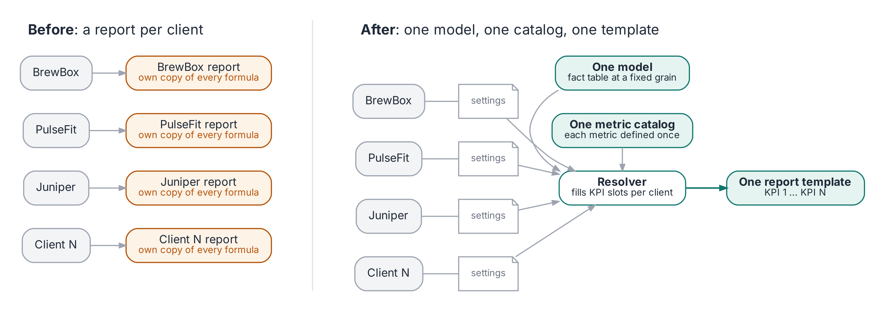

# config-driven-reporting

A small, runnable reference implementation of one idea: **serve many audiences
from one data model and one report template, and put everything that differs
between them in configuration.** The audiences can be agency clients (the
example used here), business units, brands, regions or markets: any setting
where many groups need the same kind of report built around their own KPIs.

It accompanies the article *One Model, a Hundred Clients* (configuration-driven
reporting: one semantic model, one metric catalog, and a few lines of
configuration per audience) by Val Ye [link once published]. All data is
synthetic and all three clients are fictional.

## The idea in one picture



```
raw source data ──> one dimensional model ──> metric catalog ──> resolver ──────> one report template
                    (model/schema.sql)        (semantic/          (semantic/        (report/render.py)
                                               metrics.yaml)       resolve.py)
                                                      ▲                 ▲
                                    KPI templates ────┘                 └──── one record per client
                                    (semantic/kpi_templates.yaml)             (config/clients.yaml)
```

- **One model.** Every client's data lands in the same fact table at one grain
  (client x campaign x channel x day). Only additive measures are stored;
  ratios are computed from their parts after aggregation. Sources that only
  send weekly totals get their own fact table on the same dimensions.
- **One metric catalog.** Each metric is defined once, as a base measure, a
  ratio (numerator / denominator) or a formula with declared inputs
  (`semantic/metrics.yaml`).
- **KPI templates.** The standard KPI set for each kind of goal: cpa, roas,
  roi, reach (`semantic/kpi_templates.yaml`). A client can use more than one.
- **Per-client configuration.** Conversion name, reporting week, KPI types,
  which measures the client actually sends, what the client calls each
  metric (same math, different name), agreed adjustments and targets
  (`config/clients.yaml`).
- **Resolver.** Turns "KPI 1 ... KPI N" into SQL for one client, drops any
  metric the client's data cannot support, and says why (`semantic/resolve.py`).
- **One template.** Onboarding a client is a config change, not a new report.

## Quick start

```bash
pip install -r requirements.txt
make            # generate data, build the model, render reports
make test       # validate config and resolver
```

Without `make`:

```bash
python generator/make_synthetic.py
python model/build.py
python report/render.py
python tests/test_resolve.py
```

Reports appear in `reports/`: one per client, same template.

| Client | What it shows off |
|---|---|
| `brewbox` | CPA on a Monday week; calls its sessions "Visits", so the report says Cost per Trial and Visits over the shared SQL |
| `pulsefit` | CPA, no session data (two metrics listed under "Not shown"), a radio source that only arrives weekly, and a 1.15 install adjustment |
| `juniper` | ROAS and CPA templates merged, under its own names: CPA is "CPO" and ROAS is "ROI" |

Add a fourth client to `config/clients.yaml` and the same template produces its report.

`python examples/ratio_trap.py` shows why ratios are never stored.

## Directory tree

```
config-driven-reporting/
├── README.md
├── LICENSE
├── CITATION.cff              # how to cite this repository
├── Makefile                  # make / make test / make figures / make clean
├── requirements.txt          # duckdb, pyyaml (figures also need Graphviz + Pillow)
├── generator/
│   └── make_synthetic.py     # fictional clients; daily data plus one weekly-only source
├── model/
│   ├── schema.sql            # the shared dimensional model (daily and weekly facts)
│   └── build.py              # loads CSVs into data/warehouse.duckdb
├── semantic/
│   ├── metrics.yaml          # metric catalog: base, ratio, formula
│   ├── kpi_templates.yaml    # standard KPI set per goal (cpa, roas, roi, reach)
│   └── resolve.py            # KPI slots -> SQL; availability; config and grain checks
├── config/
│   └── clients.yaml          # one record per client
├── report/
│   └── render.py             # the single report template
├── examples/
│   └── ratio_trap.py         # average of ratios vs ratio of sums
├── figures/
│   └── make_figures.py       # draws the article figures (PNG + SVG)
├── tests/
│   └── test_resolve.py
├── data/                     # generated, git-ignored
└── reports/                  # generated, git-ignored
```

## Onboarding a new client (maintenance SOP)

1. Add a record to `config/clients.yaml`: `name`, `week_start`, `conversion`
   (singular, e.g. Install), `kpi_types`, `sends`, optional `labels` (what the
   client calls each metric), `adjustments`, `extra_kpis` and `targets`.
   At onboarding, ask two questions for every KPI: how do you calculate it,
   and what do you call it? The first maps to a catalog definition (or adds a
   new one, once, for everyone); the second becomes a label.
2. Run `make test`. Validation fails on unknown KPI types or metrics, unknown
   measures in `sends`, an invalid week start, or a target on an unknown metric.
3. Run `make report`. The build also warns when config and data disagree
   (config says a client sends revenue but the data has none, or the reverse),
   and stops if a weekly source's weeks do not start on the client's week start.

To add a **metric**: add it to `semantic/metrics.yaml` (a ratio needs only
`num` and `den`; a formula needs `sql` and `requires`), then add it to a KPI
template or to a client's `extra_kpis`.

To add a **KPI type**: add a list to `semantic/kpi_templates.yaml`.

To add a **weekly-only source**: load it into `fact_weekly_performance` with
week starts that match the client's `week_start`. Never spread weekly totals
across days.

## Trade-offs and limits

- N is a deliberate constraint: a handful of slots keeps the template readable and
  forces a conversation about what matters. Clients needing something truly
  custom get a custom page, not an ever-growing list of slots.
- The model assumes a fixed grain. Coarser sources (weekly totals) get their
  own fact table and reports roll up to the coarser grain; a weekly number
  cannot be broken back down to days, and misaligned week boundaries cannot be
  fixed without guessing.
- Non-additive measures such as unique reach do not fit this pattern: they
  cannot be summed across days or channels and must be computed from source at
  the level requested.
- Adjustments change reported numbers, so they belong under change control.
- The first and last weeks in the data are partial; a production version
  should flag incomplete periods so they are not read as misses.
- Mature semantic-layer tools (dbt Semantic Layer, Cube, LookML) provide the
  same separation with far more: joins, caching, access control, APIs. This
  repository shows the pattern at its smallest.

## Publishing and updating

- Tag a release on GitHub (`v1.0.0`), then archive it on Zenodo to receive a
  DOI; put the DOI in `CITATION.cff` and this README.
- For later changes: edit, run `make test`, update the version in
  `CITATION.cff`, tag a new release. Zenodo mints a new version DOI.

## License

MIT. See `LICENSE`.
